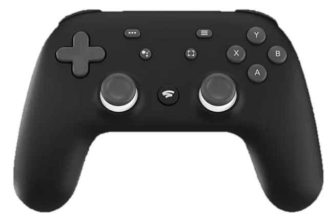

<p align="center"></p>

<h1 align="center">Pad Companion</h1>

<p align="center"><b>Give your Google Stadia controller a second life on Windows.</b><br>
Plug it in or pair it over Bluetooth, and every game, Steam, Epic and EA launcher sees one Xbox 360 controller.</p>

<p align="center">
  <a href="https://github.com/Eiza-1/stadia-pad-companion/releases/latest"></a>
  
  <a href="LICENSE"></a>
  <a href="https://github.com/Eiza-1/stadia-pad-companion/stargazers"></a>
</p>

<p align="center"><a href="https://github.com/Eiza-1/stadia-pad-companion/releases/latest"><b>⬇ Download the installer</b></a> · free, no account, built in Rust</p>

> Stadia shut down, but the controller is still great. If Pad Companion saved yours from a drawer, a ⭐ helps other
> Stadia owners find it.

## What it does

- **Works over USB and Bluetooth.** If both are connected, USB wins, so there is only ever one controller.
- **No double input.** The real pad is hidden from games with HidHide; it's opened shared, so no app gets locked out.
- **Special buttons with real jobs.** Assistant opens Gemini. Capture takes a screenshot (tap) or starts/stops a
  recording (hold) with Xbox Game Bar, Steam, NVIDIA or AMD. Hold Stadia for 1 s to open Pad Companion over any game.
- **Performance modes.** Basic for everyday play. Competitive adds no smoothing and a game-priority input thread with
  a 1 ms system timer while a pad is connected. Live report-rate and latency read-outs show what you actually get.
- **Rumble Translation Engine.** Games' Xbox vibration is translated for the Stadia pad's two motors with a Default,
  Competitive or Immersive profile and a strength setting (USB only: see below).
- **Button mapping, dead zones, response curves, trigger ranges, hair trigger, profiles.** The live pad photo moves
  with the real one on every configuration page.
- **Gemini overlay.** Press Assistant over any app: tap to type with the pad (the Orbit rail keyboard), hold to
  talk and let go to send. Short answers appear at the bottom of the screen and fade on their own, or can be read
  aloud. Uses your own free Gemini key (Other settings › Gemini), saved only on your PC.
- **Gemini Live.** Double-tap Assistant to talk with Gemini in real time. It can see your game if you share the
  screen, and it appears in a liquid-glass panel (Light glass, Frosted glass or Nearly solid).
- **Tray menu.** Right-click the tray icon for the pad, its connection and battery, Open, Settings, Start with
  Windows and Quit.
- **Costs nothing in the background.** A Rust core with no busy loops. The window is destroyed when you close it,
  so its WebView2 processes exit. In testing: about 8 MB private memory and 0 CPU while idle.

## Requirements

- Windows 10 1903 or later
- [ViGEmBus](https://github.com/nefarius/ViGEmBus/releases/latest): required, so games can see the Xbox controller
- [HidHide](https://github.com/nefarius/HidHide/releases/latest): recommended, so games don't also see the Stadia pad

The installer checks for both and offers the official download pages. Drivers are never bundled.

## Honest notes

- **Report rate.** The pad reports at 125 Hz over USB. That's the pad's own limit: Windows already asks it for a
  report every 4 ms, so no polling setting or driver can raise it. Over Bluetooth the radio link sets the pace;
  Windows' own 10 ms link is already the fastest for this pad, so Pad Companion leaves it alone.
- **Rumble over Bluetooth.** Windows doesn't deliver vibration to this pad over Bluetooth (a limit of its Bluetooth
  firmware), so rumble works over the USB cable only.
- **Battery.** The pad's report rate doesn't change between modes, so pad battery use is about the same. Competitive
  uses a little more PC power.
- **Capture.** Auto uses the first recorder available: Xbox Game Bar, then Steam (in a Steam game), NVIDIA, AMD.
  With none available, a tap saves a full-screen Windows screenshot and recording is unavailable.

## Pairing over Bluetooth

Hold **Stadia + Y** for 2 seconds until the light blinks, then add it in Windows Settings › Bluetooth & devices. If
Windows pairs it but Pad Companion says *Not connected*, remove the device and pair again: Windows sometimes skips the
controller service on the first try.

## Build from source

Requires Rust (MSVC toolchain), the Visual Studio C++ Build Tools and the Tauri CLI (`cargo install tauri-cli`).

```sh
cargo test --workspace          # core logic tests
sh scripts/check-ui.sh          # UI module syntax check
cd app/src-tauri && cargo tauri build   # installer in target/release/bundle/nsis
```

Settings and the log live in `%LOCALAPPDATA%\PadCompanion`.

## License

[MIT](LICENSE). Not affiliated with Google. Stadia is a trademark of Google LLC.
